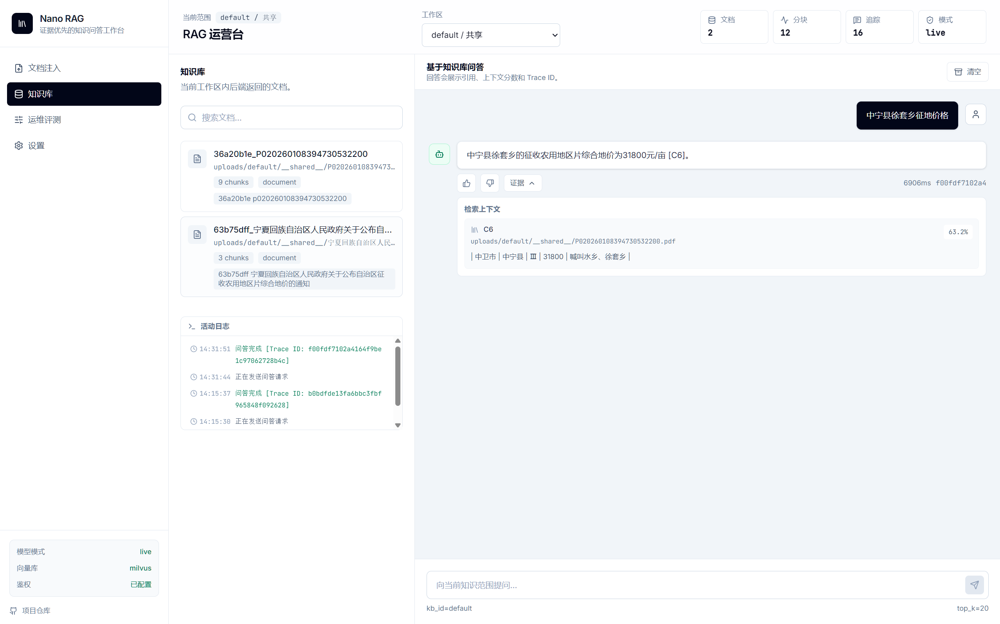

# Nano RAG

Nano RAG 是一个真实数据优先的企业 RAG 工作台。后端负责文档注入、解析、分块、**文档级 BM25 发现**、agentic 检索与深读、生成、追踪、评测和诊断；前端只展示后端已经支持的能力，不保存业务密钥，不内置 mock 数据，也不通过写死选项伪造状态。



## 快速开始

```bash
docker compose -f docker/docker-compose.yml up -d --build
```

访问地址：

- 前端/API 统一入口：`http://127.0.0.1:3001`

默认只暴露前端一个 host 端口；后端、PostgreSQL、Redis 和 Celery worker 都只在 Docker 网络内通信。

如果只做本地 UI/接口验证，不需要 PostgreSQL 和 Celery worker，可使用 lite 覆盖文件，只启动 `app` 和 `frontend` 两个容器：

```bash
docker compose -f docker/docker-compose.lite.yml up -d --build
```

lite 模式使用 artifact 图扩展（无数据库）和 background ingest；正式规范压测仍建议使用默认生产栈（postgres 图存储）。

浏览器**不持有业务密钥**：nginx 只为 `/v1/rag/` 业务路由注入业务 key。
但**运维路由**（注入、上传、追踪、评测、回放、`/health/detail`）需要调用方自备管理密钥，
在前端「设置 → 运维密钥」里填入 `RAG_ADMIN_API_KEYS` 中的任意一个值即可（存在浏览器 localStorage，
以 `X-Admin-API-Key` 发送）；不填则这些面板会明确提示“运维数据不可用”，而不是显示空数据。

`RAG_API_KEYS` / `RAG_ADMIN_API_KEYS` / `RAG_PROXY_API_KEY` 都必须显式设置（见 `docker/.env.example`），
compose 在缺失时会直接拒绝启动；不再有 `nano-rag-local` 这类默认密钥。
`RAG_PROXY_API_KEY` 通常与 `RAG_API_KEYS` 取值一致。

启动后优先检查真实运行状态：

```bash
# 公开摘要（无鉴权）
curl -sS http://127.0.0.1:3001/health
# 运维详情（需要管理密钥）
curl -sS -H "X-Admin-API-Key: $RAG_ADMIN_API_KEYS" http://127.0.0.1:3001/health/detail
# 业务查询（由 nginx 注入业务 key）
curl -sS http://127.0.0.1:3001/v1/rag/knowledge-bases
# 可注入来源（运维路由）
curl -sS -H "X-Admin-API-Key: $RAG_ADMIN_API_KEYS" http://127.0.0.1:3001/v1/rag/ingest/sources
```

## 项目理念

Nano RAG 的核心原则是：**真实输入、真实索引、真实模型、真实错误**。

- **不 mock**：运行时不使用 mock 网关，不把假数据展示成可用能力。
- **不回退**：generation、document parser 都必须显式配置；缺少配置或上游失败时直接暴露错误。
- **无稠密向量回退**：检索引擎是文档级 BM25 发现 + agentic 深读，不存在稠密/混合向量路径作为静默兜底。
- **后端是事实来源**：知识库、可注入文件、文档列表、追踪、评测数据集、报告和诊断对象都来自后端接口。
- **前端不配置密钥**：浏览器通过上层业务后端、网关或 Docker 代理与后端连接；本地 Docker 代理会注入默认业务 API key。
- **知识库优先**：所有业务操作都挂在 `kb_id` 表示的知识库下，前端必须先选择后端返回的知识库。
- **证据优先**：回答必须带引用、上下文和 trace，问题排查必须能回到原始文档、分块和模型请求链路。

这意味着系统更愿意失败得明确，也不做静默降级。错误的 API key、不可用的解析器、不可达的 PostgreSQL、空的 provider key，都应该被看见和修复。

## 当前能力

- 业务 API（业务 key）：`/v1/rag/chat`、`/v1/rag/chat/stream`、`/v1/rag/retrieve`、`/v1/rag/ingest/jobs/{job_id}`、`/v1/rag/documents`、`/v1/rag/knowledge-bases`、`/v1/rag/feedback`、`/v1/rag/traces/{trace_id}`
- 运维 API（管理 key）：`/v1/rag/ingest`、`/v1/rag/ingest/upload`、`/v1/rag/ingest/sources`、`/v1/rag/benchmark/run`、`/health/detail`
- 文档结构 API：`/v1/rag/documents/{doc_id}/tree`、`/v1/rag/nodes/{node_id}`、`/v1/rag/tables/{table_id}`、`/v1/rag/graph/neighborhood`
- 运维 API：`/health/detail`、`/debug/storage`、`/debug/parsed/{doc_id}`、`/retrieve/debug`、`/traces`、`/replay/{trace_id}`
- 评测和诊断：`/eval/datasets`、`/eval/reports`、`/eval/run`、`/benchmark/reports`、`/diagnose/*`
- 发现层：文档级 BM25 索引（编译后的 wiki 页），是 agentic 检索的第一跳；无向量库、无 embedding 模型
- 图存储：原生 PostgreSQL 物化文档结构（节点/实体/关系），支撑可选的图扩展；本地脚本可退回 artifact 存储
- 摄入解析：内置 parser registry，支持 Markdown、TXT、HTML、CSV/TSV、JSON/JSONL、YAML、XML、DOCX、XLSX、PPTX、数字版 PDF、本地媒体文件；旧版 DOC/XLS/PPT、扫描 PDF 和图片重文档通过已配置的多模态 document parser 解析
- 文档结构：保留章节、条款、定义、表格 summary、表格 row-level chunk、来源 hash、文件版本元数据、parser 名称、chunk_strategy 和索引 schema 版本
- 图片索引：图片文件默认生成视觉媒体 chunk；如果配置了多模态 document parser 且能抽出文字，会同时生成文本/结构 chunk
- agentic 检索：wiki BM25 发现 → 确定性版本过滤（按 `source_key` 取最新）→ LLM 结构化读计划（json_schema）→ 深读选中的 parsed artifact → 上下文构建；每个阶段进 trace
- 证据治理：生成结果带 structured supporting claims，并在后处理里标记 claim 是否有引用支撑、缺失数字和缺失术语
- 模型路径：**一个 provider 走天下**——查询理解、阅读计划、证据审计、图抽取、答案生成由同一个生成模型完成，文档解析由该 provider 的多模态模型完成。**不配置 embedding 模型、不配置 rerank 模型、也没有任何本地解析**
- 前端：React + Vite 源码位于 `frontend/` 子模块，Docker 构建为 nginx 静态站点并代理后端

## 目录

```text
nano-rag/
├─ app/              # FastAPI 后端（agentic 发现 + 检索 + 生成）
├─ configs/          # settings/models/prompts
├─ data/             # raw/eval/wiki 样例数据
├─ docker/           # Dockerfile、Compose、nginx 配置
├─ frontend/         # React + Vite 前端子模块
└─ scripts/          # eval/benchmark/smoke 等脚本
```

## Docker 配置

### 只有两项需要你填

```bash
python scripts/init_env.py           # 一键生成 docker/.env（含随机密钥）
python scripts/init_env.py --check   # 随时检查还缺什么
```

生成后只需补两个值：

| 变量 | 用途 | 何时必需 |
| --- | --- | --- |
| `GENERATION_API_KEY` | 生成模型：对话、阅读计划、证据审计、**图抽取**都走它 | 总是（文本摄入也要图抽取） |
| `DOCUMENT_PARSER_API_KEY` | 多模态文档解析 | 只在摄入 PDF / 图片 / Office 时；纯 md/txt 不需要 |

其余全部自动生成或派生，**不需要你操心**：

| 项 | 为什么不需要配 |
| --- | --- |
| `RAG_API_KEYS` / `RAG_ADMIN_API_KEYS` / `POSTGRES_PASSWORD` | `init_env.py` 用 `secrets.token_hex` 生成（等价 `openssl rand -hex 32`） |
| `RAG_PROXY_API_KEY` | 由 `RAG_API_KEYS` 派生（nginx 注入的那一个 key） |
| `PG_URI` | 由 `POSTGRES_USER` / `POSTGRES_PASSWORD` / `POSTGRES_DB` 派生，一处定义 |
| `MODEL_GATEWAY_*` | 历史别名，`GENERATION_*` 是唯一来源（代码保留只读兼容） |
| `COMPOSE_*` 前缀名 | 旧格式，迁移时自动转换并保留原值 |
| `RAG_WIKI_ENABLED` | 必须为 `true`（`false` 会启动失败），无需配置 |
| `MODEL_GATEWAY_MODE` | 只支持 `live`（`mock` 已被拒绝），无需配置 |
| redis / postgres 的对外认证 | 两者都是 `expose`-only，不在宿主机暴露，属内部交换组件 |

### 环境对照

| 场景 | 需要什么 |
| --- | --- |
| 跑测试 / 检索评测 / dedup / 分词 A/B / 引用校验 | **什么都不需要**（无 LLM 调用） |
| 真实问答（端到端） | `GENERATION_API_KEY` |
| 摄入 PDF / 图片 / Office | 再加 `DOCUMENT_PARSER_API_KEY` |

### 启动

```bash
docker compose -f docker/docker-compose.yml up -d --build

# 公开摘要（无鉴权）
curl -sS http://127.0.0.1:3001/health
# 运维详情（需要运维密钥；会逐项报告哪个能力不可达）
curl -sS -H "X-Admin-API-Key: $(grep ^RAG_ADMIN_API_KEYS= docker/.env | cut -d= -f2)" \
  http://127.0.0.1:3001/health/detail
```

`/health/detail` 是判断"配置是否真的可用"的地方：它会真实探测 provider 可达性并返回具体错误，
比逐个猜环境变量快得多。

### 安全默认

- 前端默认只绑 `127.0.0.1`。改成 `0.0.0.0` 之前请在前面放鉴权代理——该端口会注入业务密钥，
  能访问它的人等同业务调用者。
- `RAG_ENV=local` 才允许弱默认密钥；其他取值会拒绝已知弱密钥。
- `RAG_AUTH_DISABLED` 只在 local/dev/test 生效，生产环境会被忽略并记日志。
- `/docs` 与 `/openapi.json` 默认关闭，需要时 `RAG_ENABLE_DOCS=true` 显式开启。

## Provider 配置

真实模型调用需要配置 provider key。默认工程不再启动 Bifrost 或 LiteLLM，也不读取它们的密钥文件。只保留两套推荐配置：Gemini 或 Qwen。

模型 provider 抽象按能力拆分：

- `generation`：OpenAI-compatible chat completions，支持 Gemini、Qwen DashScope、Qwen vLLM。
- `document_parser`：`gemini` 使用 Gemini Files API；`qwen` 使用 OpenAI-compatible chat completions，可指向 DashScope 或 vLLM。
- `trace`：默认写入本地 `TraceStore`，可选通过 `LANGFUSE_OTEL_ENDPOINT` 对接外部 Langfuse；默认 Docker 栈不再内置 Langfuse 容器。

Gemini 示例：

```bash
GENERATION_API_KEY=<your-gemini-key>
GENERATION_API_BASE_URL=https://generativelanguage.googleapis.com/v1beta/openai
GENERATION_MODEL_ALIAS=gemini-flash-latest

DOCUMENT_PARSER_API_KEY=<your-parser-key>
DOCUMENT_PARSER_API_BASE_URL=https://generativelanguage.googleapis.com
DOCUMENT_PARSER_MODEL=gemini-flash-latest
```

## 公开 RAG 评测

公开数据集用于通用 RAG 基线，规范/标准语料压测用于业务场景基线。可先抽样公开数据生成 `data/raw/public_eval/...` 和 `data/eval/*.jsonl`：

```bash
python scripts/prepare_public_rag_eval.py --dataset ragbench-delucionqa --limit 20
python scripts/prepare_public_rag_eval.py --dataset hotpotqa --limit 20
```

然后在 Docker 栈内摄入对应 raw 目录，并复用现有评测：

```bash
docker compose -f docker/docker-compose.yml exec app python scripts/run_eval.py --dataset data/eval/ragbench-delucionqa.jsonl
```

Qwen 示例：

```bash
GENERATION_API_KEY=<your-dashscope-key>
GENERATION_API_BASE_URL=https://dashscope-intl.aliyuncs.com/compatible-mode/v1
GENERATION_MODEL_ALIAS=qwen-plus

DOCUMENT_PARSER_PROVIDER=qwen
DOCUMENT_PARSER_API_KEY=<your-dashscope-key>
DOCUMENT_PARSER_API_BASE_URL=https://dashscope-intl.aliyuncs.com/compatible-mode/v1
DOCUMENT_PARSER_MODEL=qwen-vl-plus
```

Qwen vLLM 自托管示例：

```bash
GENERATION_API_KEY=EMPTY
GENERATION_API_BASE_URL=http://vllm:8000/v1
GENERATION_MODEL_ALIAS=Qwen/Qwen2.5-VL-7B-Instruct

DOCUMENT_PARSER_PROVIDER=qwen
DOCUMENT_PARSER_API_KEY=EMPTY
DOCUMENT_PARSER_API_BASE_URL=http://vllm:8000/v1
DOCUMENT_PARSER_MODEL=Qwen/Qwen2.5-VL-7B-Instruct
```

如果没有有效 provider key，系统不会切到 mock；`/health/detail` 会显示 degraded，并在具体能力下返回上游错误。

PDF 和图片上传需要 `DOCUMENT_PARSER_API_KEY`。未配置时后端启动日志会输出 `Startup readiness` 警告，`/health/detail` 会返回明确缺失项，上传接口也会直接拒绝；这不是回退或 mock，而是要求补齐真实 Gemini、Qwen DashScope 或 Qwen vLLM document parser 配置。

## 知识库与数据来源

知识库由后端 `/v1/rag/knowledge-bases` 生成，来源包括：

- 本地知识库 catalog，默认包含 `default`
- `RAG_SUPPORTED_KB_IDS` 启动时预置的知识库
- 前端或 API 创建的知识库

前端不会写死知识库。注入来源由 `/v1/rag/ingest/sources` 返回，默认来自 Docker 内的 `/workspace/data/raw` 白名单目录。

Nano RAG 不实现账号系统或 workspace/组织/项目管理；这些属于上层业务系统。未来外部账号系统可以通过网关或业务后端控制可访问的 `kb_id` 集合。

上传接口使用稳定的逻辑来源路径，例如 `uploads/default/policy.pdf`。Docker 会把原始上传文件持久化到 `app-upload-data` 卷里的 `/workspace/data/uploads`，用于证据读取和可追溯 source path；临时批处理目录会在注入请求结束后清理。

## 常用验证

所有命令都通过 Docker 暴露的服务验证真实后端：

```bash
curl -sS http://127.0.0.1:3001/health/detail
curl -sS http://127.0.0.1:3001/v1/rag/knowledge-bases
curl -sS http://127.0.0.1:3001/v1/rag/ingest/sources
curl -sS http://127.0.0.1:3001/debug/storage
docker logs --tail 120 nanorag-app
docker logs --tail 120 nanorag-frontend
```

业务接口通过前端统一入口访问时由 nginx 注入业务 key。仅在容器网络内直连后端时才需要业务 API key：

```bash
docker compose -f docker/docker-compose.yml exec app \
  python -c "import urllib.request; print(urllib.request.urlopen('http://127.0.0.1:8000/health').read().decode())"
curl -sS http://127.0.0.1:3001/health/detail \
  -H "X-Admin-API-Key: $RAG_ADMIN_API_KEYS"
```

## API 示例

路径注入：

```bash
curl -sS -X POST http://127.0.0.1:3001/v1/rag/ingest \
  -H 'X-RAG-Admin-Key: <your-admin-key>' \
  -H 'Content-Type: application/json' \
  -d '{"path":"/workspace/data/raw/employee_handbook.md","kb_id":"default"}'
```

问答：

```bash
curl -sS -X POST http://127.0.0.1:3001/v1/rag/chat \
  -H 'Content-Type: application/json' \
  -d '{"query":"请输入你的真实业务问题","kb_id":"default","session_id":"manual-session","top_k":4}'
```

仅检索上下文，不调用生成模型：

```bash
curl -sS -X POST http://127.0.0.1:3001/v1/rag/retrieve \
  -H 'Content-Type: application/json' \
  -d '{"query":"请输入你的真实检索问题","kb_id":"default","session_id":"manual-session","top_k":10}'
```

检索调试：

```bash
curl -sS -X POST http://127.0.0.1:3001/retrieve/debug \
  -H 'X-RAG-Admin-Key: <your-admin-key>' \
  -H 'Content-Type: application/json' \
  -d '{"query":"请输入你的真实检索问题","kb_id":"default","top_k":10}'
```

## 生产部署前置项

本仓库默认配置面向本地验证。上线前至少完成以下调整：

- 显式设置 `RAG_API_KEYS`、`RAG_ADMIN_API_KEYS`、`RAG_PROXY_API_KEY`、`PG_PASSWORD`；`RAG_ENV` 保持非 local/dev/test 即可让服务拒绝已知弱默认密钥。
- `RAG_AUTH_DISABLED` 只在 `RAG_ENV=local|dev|development|test|testing|unittest` 时生效，生产环境会被忽略并记日志。
- `/docs` 与 `/openapi.json` 默认关闭，需要时用 `RAG_ENABLE_DOCS=true` 显式开启（它们会暴露全部运维路由）。
- 业务接口使用 `RAG_API_KEYS` 或可信上游网关；管理、调试、评测、诊断和 replay 接口使用独立的 `RAG_ADMIN_API_KEYS`。
- 如果由业务网关做登录和租户控制，设置 `RAG_TRUSTED_PROXY_SECRET`，并让网关注入 `X-RAG-Proxy-Secret`、`X-RAG-Principal-Id`、`X-RAG-Org-Id`、`X-RAG-Allowed-KB-Ids`。
- 设置 `RAG_RATE_LIMIT_REQUESTS_PER_MINUTE`，并在外层网关或 WAF 做全局限流；仓库内的限流是单进程保护，不替代分布式限流。
- 为 PostgreSQL 图存储和 `app-parsed-data`、`app-report-data`、`app-upload-data`、`app-wiki-data` 卷建立备份、恢复和迁移流程。
- 默认不再保存完整 prompt 到 trace；只有设置 `RAG_TRACE_STORE_PROMPTS=true` 时才会写入 `prompt_messages`。
- 模型 provider 默认对 408/409/425/429/5xx 和超时做退避重试；可通过 `MODEL_PROVIDER_MAX_RETRIES`、`MODEL_PROVIDER_RETRY_BASE_SECONDS`、`MODEL_PROVIDER_RETRY_MAX_SECONDS` 调整。

生产常见文档处理：

- 直接支持：Markdown、TXT、HTML、CSV、DOCX、XLSX、图片、音频、视频、PDF。
- CSV/DOCX/XLSX 使用本地结构化抽取，保留基础段落、表格和单元格值；复杂版式、扫描件、图片型 PDF、图表型材料仍应配置多模态 document parser。
- 上传大小由 `MAX_UPLOAD_BYTES` 控制，单批文件数由 `MAX_FILES_PER_BATCH` 控制；生产应在网关层同步设置 body size、杀毒/内容安全扫描和文件类型白名单。
- 对标准、法规、合同、制度类文档，建议在文件名或正文中保留版本号、生效日期、章节号；发现层会使用 `doc_type`、`effective_date`、`version`、`source_key` 等元数据做确定性版本过滤。

评测门禁示例（答案级）：

```bash
python scripts/run_eval.py \
  --dataset data/eval/employee_handbook_eval.jsonl \
  --min-context-recall 0.85 \
  --max-conflicting-hit-rate 0.05
```

检索阶段门禁（只跑 wiki BM25 发现 + 版本过滤，**不调用任何模型**，适合放进 CI）：

```bash
python scripts/run_retrieval_eval.py \
  --dataset data/eval/retrieval_employee_handbook.jsonl \
  --min-recall-at 12=0.9 --min-mrr 0.5
```

它回答的是“发现阶段有没有把正确文档找出来”，与答案级指标互补：分词方式、`discovery_top_k`、
版本过滤规则的改动是否真的有效，只有这个指标能判断。格式见 `data/eval/README.md`。

### 中文分词 A/B

中文没有词间空格，分词器决定"一个词是什么"，这是纯词法索引上最大的相关度杠杆。
`RAG_BM25_TOKENIZER` 提供三种模式（非 CJK 文本在所有模式下切分完全一致，因此 A/B 只测 CJK 差异）：

| 模式 | 切分方式 | 特点 |
| --- | --- | --- |
| `cjk_ngram`（默认） | 单字 + 双字 | 召回高、精度低：每个常用字都是词项，IDF 区分度被稀释 |
| `cjk_bigram` | 仅双字 | 去掉单字噪声地板；**已知限制**：单字查询无法命中多字文档 |
| `jieba` | 词典词（search 模式） | 词项精确、IDF 对比最好；依赖分词词典，词典不认同的词边界会漏 |

复现实验（用本仓库真实中文语料切分出的 19 篇文档 + 19 条原文查询）：

```bash
python scripts/build_cjk_tokenizer_benchmark.py --out /tmp/cjkbench
for mode in cjk_ngram cjk_bigram jieba; do
  RAG_BM25_TOKENIZER=$mode PARSED_OUTPUT_DIR=/tmp/cjkbench/parsed \
    WIKI_OUTPUT_DIR=/tmp/cjkbench/wiki \
    python scripts/run_retrieval_eval.py --dataset /tmp/cjkbench/retrieval.jsonl
done
```

结果（`separation_ratio` = 正确文档相对最强错误文档的领先幅度，尺度无关，可跨分词器比较；
`cand` = 平均误命中候选数）：

| query 长度 | cjk_ngram | cjk_bigram | jieba |
| --- | --- | --- | --- |
| 12 字 | 0.708 / 11.6 | **0.794 / 6.6** | 0.712 / 9.4 |
| 18 字 | 0.720 / 11.7 | **0.806 / 7.3** | 0.703 / 10.4 |
| 24 字 | 0.758 / 11.9 | **0.833 / 8.2** | 0.743 / 11.0 |

三种查询长度下结论一致：`cjk_bigram` 的分离度最高，且误命中候选约为 ngram 的一半——与
"单字是噪声、jieba 的子词展开产生部分匹配"的解释一致。

**但默认值保持不变**（仍是 `cjk_ngram`）：语料只有 19 篇且查询是原文片段，recall 已饱和
（三种模式 r@1 均为 1.00），无法证明 bigram 在更难查询上不丢召回；它还有"单字查询打不中"
这个已知缺陷。**把这个实验在你的真实语料上重跑一次再决定是否切换**，不要根据这 19 篇的数据改默认值。

注意 `separation_margin`（绝对分差）只能在同一配置的不同运行之间比较，不能跨分词器——产出词项
更多的分词器原始 BM25 分数天然更大。跨配置请用 `separation_ratio`。

### 在公开中文语料上的 A/B 结论

之前的 A/B 只能用仓库自带的几 KB 中文散文，且查询是原文片段，recall 全部饱和到 1.00——
那个"结论"是查询构造的假象，已被下面的真实实验取代。

基准来自公开数据集 **C-MTEB/T2Retrieval**（118k 段落 / 22k 查询 / 118k 相关judgement），
抽样为 4,408 篇文档 + 200 条真实用户查询（另做一次独立抽样复现）：

```bash
python scripts/build_public_retrieval_benchmark.py --out /tmp/t2r-bench
python scripts/ab_retrieval.py tokenizer --benchmark /tmp/t2r-bench
```

**分词（两次独立抽样结论一致）**

| 模式 | recall@1 | recall@4 | recall@12 | MRR |
| --- | --- | --- | --- | --- |
| `cjk_ngram`（默认） | 0.4475–0.4717 | 0.7683–0.7808 | 0.8292–0.8600 | 0.8633–0.8653 |
| `cjk_bigram` | 0.4258–0.4808 | 0.7400–0.7692 | 0.7892–0.8392 | 0.8332–0.8633 |
| `jieba` | 0.4408–0.4558 | 0.7275–0.7500 | 0.7833–0.8292 | 0.8377–0.8450 |

**默认值保持不变**：`cjk_ngram` 在两次抽样里召回都最好。`cjk_bigram` 的分离度略高，
但 recall@4/@12 更低、未召回更多。发现层是喂给 LLM 阅读计划的第一跳——阅读计划能丢弃噪声，
但无法找回从未发现的文档，所以这里召回优先。

### 评测指标一览与显著性

我们区分两种指标，"有没有找到"和"排得好不好"是不同的问题：

| 指标 | 回答的问题 | 类型 |
| --- | --- | --- |
| `recall@k` / `hit@k` | 找到了没有？ | 确定性 |
| `MRR` | 第一个正确答案来得早不早？ | 确定性 |
| `nDCG@k` | 整体排序好不好、高价值结果是否靠前？ | 确定性（支持分级相关度） |
| `ndcg@k` vs `mrr` | MRR 只看第一个命中；nDCG 按位置折损整个排序 | — |
| `answer_exact_match` | 答案与参考答案是否严格一致 | 确定性 |
| `reference_context_recall` | 参考答案所需上下文是否检索到 | 确定性 |
| `citation_integrity` | 引用标签能否解析、引用句数字是否有依据 | 确定性 |
| `faithfulness` / `answer_relevancy` / `context_precision` / `context_recall` | 语义质量 | LLM（deepeval） |

**为什么必须有显著性检验**：两个 200 条查询的样本，任何配置都会差那么零点几。我们曾经差点因此改掉 BM25 默认值：

| 指标 | 样本 A | 样本 B |
| --- | --- | --- |
| recall@4 | +0.0150（显著，p=0.017） | +0.0075（不显著，p=0.40） |
| ndcg@4 | +0.0110（显著，p=0.030） | +0.0082（不显著，p=0.17） |
| ndcg@12 | +0.0067（不显著） | +0.0083（显著，p=0.028） |

方向在两个样本上都是正的，但**显著性在样本间翻转**——这说明差异没有稳健到可以据此改默认值。
所以 `k1=1.5 / b=0.75` 保持不动，等有足够样本量时再定。

```bash
# 比较两份报告：配对 bootstrap + 逐查询胜负
python scripts/compare_eval_reports.py --baseline a.json --candidate b.json \
    --metrics recall@4,ndcg@4,ndcg@12,mrr
```

输出包含均值、95% 置信区间、p 值、逐查询 win/loss/tie，并明确指出差异是否超出噪声。
`--require-significant` 可以当 CI 门槛用。

### 为什么没有 rerank（以及这个选择的代价）

本项目的目标是**一个模型走天下**：不引入 embedding 模型，也不引入 rerank 模型。因此重排阶段已从
代码里彻底移除（客户端、配置、健康探测、trace 字段、A/B 工具链全部删除），而不是"留着但默认关闭"。
留着一个永远不会被调用的能力，等于让 `/health/detail` 报告一个不存在的能力——这正是本项目一直在清理的
那类假承诺。

这个选择的代价有实测数据（在 C-MTEB/T2Retrieval 抽样的 50 条查询上，用聊天模型当评审模拟重排）：

| 指标 | 无重排（当前架构） | 若有 cross-encoder 重排 | 差距 |
| --- | --- | --- | --- |
| recall@1 | 0.5233 | 0.6033 | +8.0 pt |
| recall@4 | 0.8433 | 0.9133 | +7.0 pt |
| MRR | 0.9127 | 0.9850 | +7.2 pt |

也就是说：不做重排，top-1 命中率大约低 8 个百分点。**这是有意接受的成本**，换取的是一套只需一个模型
凭据、无需额外模型部署与运维的运行时。该实验只测量"重排这件事的效果"，不代表生产级 cross-encoder
的质量或延迟。

如果将来重排带来的这 8 个百分点变得不可接受，正确的做法是把 cross-encoder 作为一个显式的架构决策
重新引入（含模型部署、延迟预算、故障语义），而不是偷偷加一个可选开关。

### 解析结果会被保存和复用

解析全部走模型，所以"重复摄入同一个文件"不能每次都重新花钱。这里分两层：

**1. 内容未变：整份跳过**

摄入时先算文件内容的 SHA-256，与该路径已提交产物里记录的哈希比对，同时比对**摄入指纹**
（解析器 provider/model + 分块配置 + 产物 schema 版本）。完全一致就整份跳过——不解析、不抽图、
不重写产物、不重建索引。跳过的文档会在响应里明确列出：

```bash
curl -X POST .../v1/rag/ingest -d '{"path":"data/raw/handbook.md","kb_id":"default"}'
# 首次: {"documents":1,"chunks":3,"unchanged_doc_ids":[]}
# 再次: {"documents":0,"chunks":0,"unchanged_doc_ids":["doc-7c690a..."]}
```

实测（单份 284 字节的 md）：首次 20.7s → 未变更再次摄入 2.1s，且不产生任何模型调用。

需要强制重建时传 `"force": true`（例如人工删过 wiki 页面）。

**2. 内容相同但路径变了：只跳过解析**

解析结果按内容哈希缓存在 `data/parsed/.parse_cache/`，所以文件改名/搬目录后内容仍是同一份时，
不需要再调用模型解析一次。

缓存键是**内容哈希**，而不是路径或 mtime：文件被 touch 但内容没变 → 命中；内容变了 → 未命中。
缓存路径里还带着**配置指纹**的目录段，因此换了解析模型或分了块参数，旧缓存天然不可读——
不需要任何失效逻辑，也不会把上一版模型产出的文本喂给新版配置。

缓存损坏会报错而不是被忽略：静默重新解析会把磁盘故障藏在不报错的假象里。

| 开关 | 默认 | 说明 |
| --- | --- | --- |
| `RAG_PARSE_CACHE_ENABLED` | `true` | 关掉后每份文件都会重新调用模型解析 |

### 摄入成本可见

解析全部走模型后，"一次摄入花了多少"必须能查。每个文档的 token 用量按阶段记录
（`parse` / `graph_extraction`），累加到作业记录和响应：

```bash
curl .../v1/rag/ingest/jobs/<job_id>
# {"documents":3,"unchanged_documents":12,"prompt_tokens":1935,"completion_tokens":6049}
```

实测一份普通文档约 **2,200–2,500 tokens**，其中**约 91% 花在图谱抽取上**，解析只占约 9%：

| 阶段 | token |
| --- | --- |
| `graph_extraction` | ~2,780 |
| `parse` | ~281 |

这个比例很重要：如果摄入成本需要压缩，**杠杆在图谱抽取**（它是可选阶段，关掉可省约九成），
而不是解析。注意这两项都随文档规模增长，样本小不代表大文档的分布。

用量按**并发任务隔离**统计（`ContextVar`），不会把 A 文档的消耗算到 B 文档头上。

### 重复文档清理

同一份内容以不同路径进入同一知识库（上传 + raw 副本、文件改名、语料重组，或历史版本用了不同的
doc_id 规则）会产生多份文档。**重复不是脏数据问题，而是召回损失**：每份副本都占用一个发现槽位并
瓜分 BM25 分数，把真正的答案挤出 top-k。

摄入侧已经自动处理：新路径的文件若与库内已有文档内容完全一致，旧副本会被取代（响应里的
`superseded_doc_ids` 会如实报告，不会静默删除）。既有语料用工具清理：

```bash
# 先看计划（默认 dry-run，不动数据）
python scripts/dedup_corpus.py
# 确认后执行
python scripts/dedup_corpus.py --apply
```

判重覆盖两类，互斥且都有明确判据：

1. **内容重复**（`reason=content`）：正文指纹相同（`sha256(document.content)`）。判据刻意不用
   `source_content_hash`——历史产物没有后者，靠它会在最需要清理的语料上什么都找不到。
2. **陈旧身份**（`reason=stale_identity`）：同一知识库、同一源文件、不同 doc_id——即 doc_id 规则
   变更（UUID → `doc-` 稳定哈希）后残留的旧产物。这类文档正文往往也不同（解析器版本不同），
   内容指纹识别不了。判据刻意收窄为"一个成员是稳定 `doc-` id、其余是旧式 id"，
   正常语料不会被路径启发式误删（`reports/spec.pdf` 与 `contracts/spec.pdf` 不会互相判重）。

删除覆盖三处存储：parsed artifact、附件目录、图行、wiki 页。默认 dry-run，`--apply` 才动数据。

实测效果（本仓库自带语料：6 份内容相同的 handbook 副本 + 1 份同源旧身份副本）：

| | 清理前 | 清理后 |
| --- | --- | --- |
| parsed 产物 / wiki 源页 | 7 / 7 | **1 / 1** |
| `recall@1` | 0.33 | **1.00** |
| `recall@4` | 0.33 | **1.00** |
| `MRR` | 0.43 | **1.00** |

也就是说：在清理前，**三分之二的问题连第一名都拿不到正确答案**，纯粹因为副本占满了发现槽位。

RAG 本体回归样本位于 `data/eval/rag_quality_regression.jsonl`，覆盖表格行查值、条款定位、术语定义、版本冲突和无答案边界。生产接入新语料后，应把业务高风险问题追加到这个集合并设为 CI 门禁。

## 关键配置

- [configs/settings.yaml](./configs/settings.yaml)：agentic 检索、discovery、prompt、timeout
- [configs/models.yaml](./configs/models.yaml)：各能力的 base_url、api_key 和模型 alias
- [configs/prompts.yaml](./configs/prompts.yaml)：生成提示词

注意：

- **`source_key` 语义变更（升级须知）**：`source_key` 现在是 `"<末级目录> <标题>"`（小写、空格分隔），
  此前只有标题。旧语料的 wiki 页与 parsed artifact 里保存的是旧 key，`bootstrap_from_parsed_dir`
  不会重算，因此已有语料保持原状、不会错乱；但**重新摄入某个文件**时它会迁移到新 key 组。
  如果同一份语料里有多版本文件（如 `Policy v1` / `Policy v2`），升级后请把整组重新摄入一次，
  否则它们会短暂分属两个版本组（各自都被视为最新）。改动原因：只用标题做 key 会让
  `reports/spec.pdf` 与 `contracts/spec.pdf` 被判为同一文档的不同版本，其中一个被版本过滤静默丢弃。
- `MODEL_GATEWAY_MODE=mock` 不再是受支持的运行模式。
- `RAG_GRAPH_BACKEND` 默认生产栈是 `postgres`；本地脚本默认 `artifact`（无需数据库）。
- 检索引擎是文档级 BM25 发现 + agentic 深读；`RAG_WIKI_ENABLED` 必须为 `true`，不存在稠密向量回退。
- 默认 Docker 不启动模型网关中间层；生成、文档解析分别按显式 provider 配置直连，**没有 embedding 端点**。
- 文档解析不会回退到本地 PDF 解析器；PDF/图片解析需要启用并配置 document parser。
- 附件索引默认开启：`RAG_DOCUMENT_ATTACHMENT_INDEX_ENABLED=true`。PDF page attachment 页数上限由 `RAG_PDF_ATTACHMENT_MAX_PAGES` 控制；PDF rendered image 需要运行环境存在 `pdftoppm`，并可用 `RAG_RENDERED_PAGE_IMAGE_INDEX_ENABLED`、`RAG_RENDERED_PAGE_IMAGE_DPI` 控制；OOXML 内嵌图片由 `RAG_EMBEDDED_IMAGE_INDEX_ENABLED`、`RAG_EMBEDDED_IMAGE_MAX_COUNT` 控制。

## 测试

代码检查可以直接运行测试命令；服务启动和联调只使用 Docker：

```bash
python -m pytest app/tests
npm --prefix frontend run lint
npm --prefix frontend run build
docker compose -f docker/docker-compose.yml up -d --build
```

当前真实运行状态以 Docker 为准。没有有效 provider key 时，构建和服务健康可以通过，但注入/问答会在模型调用阶段返回真实上游错误。
